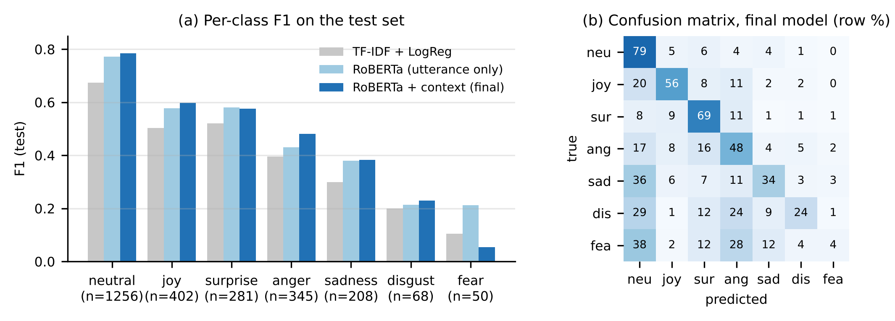
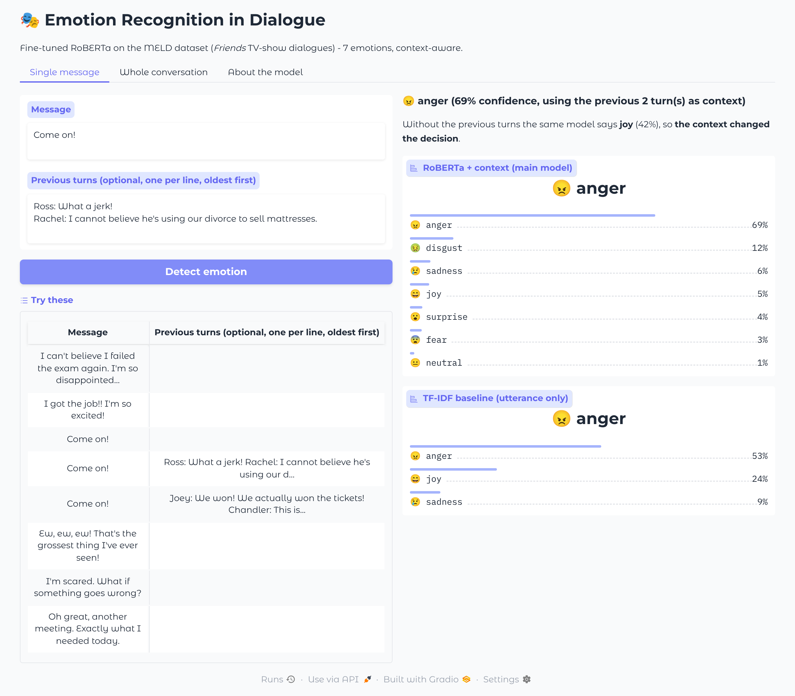

# Emotion Recognition in Dialogue

**NLP individual project #5: Emotion Recognition from Text.** Predict which emotion a speaker
expresses in each turn of a conversation: *neutral, joy, surprise, anger, sadness, disgust,
fear*.

The final model is **RoBERTa-base fine-tuned on MELD** (13.7k dialogue turns from the TV series
*Friends*). It reads the **current utterance together with the two previous turns** of the
conversation. It is compared against a majority-class baseline, a TF-IDF + logistic regression
baseline, and an utterance-only RoBERTa ablation. A Gradio web app demos it live.

<!-- RESULTS -->
## Results (test set, 2,610 utterances)

| Model | Accuracy | Weighted P | Weighted R | Weighted F1 | Macro F1 |
|---|---|---|---|---|---|
| Majority class (always *neutral*) | 0.481 | 0.232 | 0.481 | 0.313 | 0.093 |
| TF-IDF + logistic regression | 0.527 | 0.563 | 0.527 | 0.541 | 0.385 |
| RoBERTa, utterance only | 0.625 ± 0.008 | 0.629 ± 0.004 | 0.625 ± 0.008 | 0.625 ± 0.006 | 0.454 ± 0.001 |
| **RoBERTa + 2 context turns (final)** | 0.626 ± 0.010 | 0.631 ± 0.003 | 0.626 ± 0.010 | 0.626 ± 0.007 | 0.447 ± 0.008 |

RoBERTa rows are the mean ± standard deviation over 3 random seeds (42, 13, 7). The shipped model is the seed-42 run (fixed in advance, not picked as the best of the three): weighted-F1 **0.633**, macro-F1 **0.444**, accuracy **0.638**.

Ablations (seed 42, test set):

| Variant | Dev weighted F1 | Test weighted F1 | Test macro F1 |
|---|---|---|---|
| Final: 2 context turns, class weights 1/sqrt(freq) | 0.594 | 0.633 | 0.444 |
| No class weights | 0.602 | 0.623 | 0.422 |
| Inverse-frequency class weights 1/freq | 0.561 | 0.571 | 0.407 |
| 4 context turns | 0.602 | 0.620 | 0.452 |

**Key findings**

* **Fine-tuned RoBERTa clearly beats the classical baseline:** +8.4 weighted-F1 points over TF-IDF, on every seed.
* **Dialogue context did not give a reliable gain.** Paired by seed, context minus utterance-only is +0.1 weighted-F1 points on average (context wins on 1 of 3 seeds). A single-seed comparison (seed 42: +1.3) would have suggested a gain that does not replicate.
* **The context model does use the context:** removing it at test time lowers its weighted-F1 from 0.633 to 0.618, and it flips ambiguous replies ("Come on!" is anger after a complaint, joy after good news). A model trained without context compensates from the utterance alone.
* **Rare classes are hard and unstable:** fear (50 test examples) ranges from F1 0.05 to 0.22 across the three context runs.
* **The most confident errors are textually neutral turns** ("Okay.", "Yeah.", "No.") that annotators labelled from tone of voice, which shows the ceiling of a text-only model.




<!-- /RESULTS -->

## Quick start

Requires Python 3.10 or newer. No GPU is needed.

```bash
pip install -r requirements.txt
python app.py                       # demo, opens http://127.0.0.1:7860
jupyter notebook notebooks/emotion_recognition.ipynb   # full analysis (runs in about 5 min on CPU)
python -m pytest -q                 # unit tests for the data pipeline and metrics
```

The fine-tuned model ships in `models/roberta-meld-context/` (float16, split into shards under
100 MB), so **nothing has to be trained to run the demo or the notebook**.

## Repository layout

```
app.py                          Gradio demo (single message / whole conversation / about)
assets/app.css                  stylesheet of the demo (light and dark mode)
notebooks/emotion_recognition.ipynb   end-to-end notebook: data, preprocessing, baselines,
                                      evaluation, context analysis, error analysis, demo
src/emotion/
  config.py                     paths, label set, seeds
  data.py                       loading MELD, text cleaning, dialogue-context construction
  baseline.py                   majority + TF-IDF/LogReg baseline (C tuned on dev)
  train_transformer.py          RoBERTa fine-tuning (context pairs, class-weighted loss, best epoch on dev)
  evaluate.py                   accuracy / precision / recall / F1, confusion matrices
  predict.py                    inference wrappers used by the app and notebook
  runtime.py                    small hardware helpers (bfloat16 detection and autocast)
scripts/
  export_model.py               trained run -> compact float16 model in models/ (+ re-evaluation)
  make_report_figure.py         figure for the report
  convert_spacy_roberta.py      offline workaround for getting roberta-base (see below)
  verify_conversion.py          checks the converted weights layer by layer
tests/test_pipeline.py          unit tests
data/raw/                       MELD csv files (official train/dev/test split)
models/                         tfidf_logreg.joblib, roberta-meld-context/ (final model)
results/                        metrics (*.json), test-set probabilities (*.npy), figures/
report/                         1-2 page summary report (.docx + .pdf)
```

## Reproducing the experiments

```bash
python -m src.emotion.baseline                                              # baselines (about 2 min)
python -m src.emotion.train_transformer --base-model roberta-base           # final model, 2 context turns
python -m src.emotion.train_transformer --base-model roberta-base --context-turns 0   # ablation
python scripts/export_model.py runs/roberta_context models/roberta-meld-context
```

Other options: `--seed`, `--class-weight-power` (0 = unweighted, 0.5 = 1/sqrt(freq) [default],
1 = inverse frequency), `--context-turns`, `--epochs`, `--lr`. One run takes about 40 minutes on a
4-core CPU with bfloat16 support (Intel AMX); on a GPU it takes a few minutes.

**Where the pretrained weights came from.** The cloud machine used for this project could not
reach the Hugging Face Hub. It could download spaCy's English transformer pipeline
`en_core_web_trf` from GitHub, which bundles a RoBERTa-base encoder.
`scripts/convert_spacy_roberta.py` converts it into the standard `transformers` format, and
`scripts/verify_conversion.py` confirms that every layer's output matches spaCy's reference
implementation (max difference 1.5e-5). spaCy trained this encoder further on OntoNotes
(tagging, parsing, NER), so it is roberta-base with extra syntactic training. With normal
internet access, use `--base-model roberta-base`.

## Method in brief

* **Problem.** Emotion recognition in conversation, as used by empathetic chatbots, support
  ticket triage and tone analytics. Turns are short (median 6 words) and ambiguous ("Come on!"
  can be joyful or angry), so the model reads the *previous* turns. It never reads future
  turns, so it could run live.
* **Data.** MELD (Poria et al., 2019), official split 9,989 / 1,109 / 2,610 utterances.
  Heavily imbalanced: 47% neutral, under 3% each for fear and disgust.
* **Preprocessing.** Unicode and punctuation normalisation. Case, punctuation and repeated
  letters are kept on purpose, because they carry emotion. Context is the two previous turns
  of the same dialogue, without speaker names to avoid character shortcuts. Input is
  `<s> utterance </s></s> context </s>`, at most 128 tokens, and the oldest context is
  trimmed first.
* **Training.** AdamW (lr 2e-5, batch 16, 4 epochs, 6% warm-up, linear decay), cross-entropy
  weighted by 1/sqrt(class frequency), and the best epoch chosen on dev weighted-F1. The test
  set is used once. Three seeds for each of the two main configurations; ablations use one seed.
* **Metrics.** Accuracy, precision, recall and F1. Weighted-F1 is the standard MELD metric;
  macro-F1 shows rare-class performance.

## Limitations

Text only: MELD was annotated from video, so sarcasm and tone are missed. Rare emotions (fear,
disgust) remain weak and unstable across runs. Two anonymous context turns did not reliably
improve over the utterance alone. Each turn gets a single label. The domain is a 1990s US
sitcom. roberta-base was chosen to fit the CPU budget. See the report for details.

## References

1. S. Poria et al. *MELD: A Multimodal Multi-Party Dataset for Emotion Recognition in Conversations.* ACL 2019.
2. Y. Liu et al. *RoBERTa: A Robustly Optimized BERT Pretraining Approach.* arXiv:1907.11692, 2019.
3. T. Kim and P. Vossen. *EmoBERTa: Speaker-Aware Emotion Recognition in Conversation with RoBERTa.* arXiv:2108.12009, 2021.
